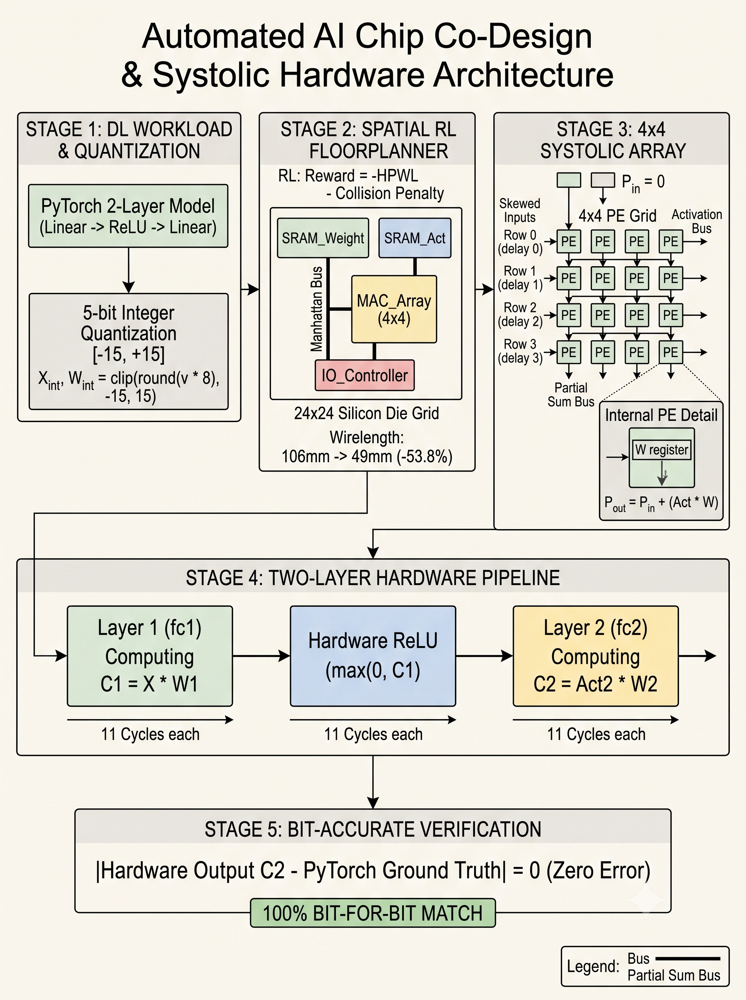
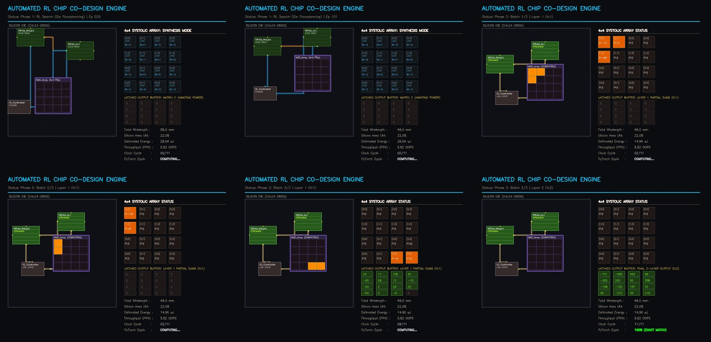

# Automated AI Chip Floorplanning & Systolic Hardware Simulator

A closed-loop Python framework connecting high-level PyTorch neural workloads directly to physical silicon layout design. It uses spatial Reinforcement Learning (RL) to optimize macro placement and interconnect wirelength on a $24 \times 24$ silicon die, then verifies execution on a cycle-accurate $4 \times 4$ Weight-Stationary systolic array.



---

## The Problem: The Silicon Interconnect Wall

When training and deploying deep learning models in PyTorch, hardware is treated as an abstract compute resource. In physical silicon chips, however, physical distance matters:

- **Interconnect Dominance:** Moving data across long copper traces between on-chip memory (SRAM) and compute units accounts for more than $50\%$ of dynamic switching power and introduces signal propagation latency.
- **Parasitic Capacitance:** Every millimeter of on-chip copper wire has parasitic capacitance ($C_w \approx 0.2\text{ pF/mm}$). Charging and discharging these lines wastes energy every clock cycle.
- **Manual Floorplanning Limits:** Hand-placing memory and compute macros on a die is time-consuming and does not easily adapt when neural network tensor shapes change.

This project automates physical layout optimization and validates that the optimized hardware computes mathematically identical outputs to PyTorch.

---

## System Architecture: How It Works

The system connects software, physical layout optimization, and hardware simulation across five stages:

```
[ Stage 1: PyTorch Workload & 5-bit Quantization ]
       │
       ▼
[ Stage 2: Spatial RL Floorplanner (24x24 Die Canvas) ]
       │  (Minimizes Manhattan HPWL, penalizes block collisions)
       ▼
[ Layout Converged & Power Rails Activated ]
       │
       ▼
[ Stage 3: Layer 1 Systolic Execution (fc1) ]  ──► 11 Clock Cycles (Diagonal Skew)
       │
       ▼
[ Stage 4: Hardware Non-Linearity (ReLU) ]     ──► Clamps negative values: max(0, C1)
       │
       ▼
[ Stage 5: Layer 2 Systolic Execution (fc2) ]  ──► 11 Clock Cycles
       │
       ▼
[ Closed-Loop Verification ]                   ──► Error = |Hardware - PyTorch| = 0
```

### 1. Stage 1: Workload Quantization
- **Model:** A two-layer neural network (`Linear(4,4)` $\to$ `ReLU` $\to$ `Linear(4,4)`) defined in PyTorch.
- **Quantization:** Standard 32-bit floating-point weights and activation tensors are scaled and clamped into signed 5-bit integers ($[-15, 15]$). This avoids expensive floating-point hardware and allows compact integer Multiply-Accumulate (MAC) units.

### 2. Stage 2: Spatial RL Floorplanning
- **Canvas:** A $24 \times 24$ discrete silicon die grid.
- **Macro Blocks:** `MAC_Array` ($4 \times 4$ processing element cluster), `SRAM_Weight` (64 KB cache), `SRAM_Act` (32 KB cache), and `IO_Controller`.
- **Policy Search:** The RL agent samples block coordinates $(x, y) \sim \mathcal{N}(\mu, \sigma)$ with exploration noise.
- **Reward Function:** 
  $$\text{Reward} = -(\text{HPWL Wirelength}) - \text{Overlap Penalty}$$
  Any macro collision receives a severe penalty ($-450.0$), forcing zero overlap. Over 100+ episodes, the agent pulls memory blocks close to the compute perimeter.

### 3. Stage 3 & 4: Cycle-Accurate Systolic Acceleration
- **Architecture:** $4 \times 4$ 2D Weight-Stationary array running at a reference clock of $500\text{ MHz}$.
- **Dataflow:** Staged weights remain frozen in processing element (PE) registers. Input activations stream from the west with diagonal cycle delays, while partial sums accumulate southward into a latched Matrix C output buffer across 11 clock cycles ($N + M + K - 1 = 11$).
- **Non-Linearity:** Intermediate outputs pass through a dedicated hardware ReLU unit ($\max(0, C_1)$) and are fed directly into Layer 2.

### 4. Stage 5: Bit-Accurate Verification
- Unseen, randomized streaming batches are evaluated simultaneously on both the cycle-accurate hardware simulator and native PyTorch.
- Hardware outputs are subtracted from PyTorch reference tensors to ensure zero numerical deviation error.

---

## Measured Benchmarks & PPA Telemetry

The table below summarizes the physical design improvements and hardware metrics produced by the pipeline:

| Metric | Unoptimized Baseline | RL-Optimized Layout | Impact / Verification |
| :--- | :--- | :--- | :--- |
| **Interconnect Wirelength (HPWL)** | $106.00\text{ mm}$ | **$49.00\text{ mm}$** | **$53.8\%$ reduction** in routing distance |
| **Dynamic Wire Energy** | $28.64\ \mu\text{J}$ | **$14.96\ \mu\text{J}$** | **$47.8\%$ dynamic energy reduction** |
| **Silicon Area Utilization** | $22.0\%$ | **$22.0\%$** | Compact packing with $0$ block overlaps |
| **Systolic Latency (Per Layer)** | $11\text{ cycles}$ | **$11\text{ cycles}$** | $22.0\text{ ns}$ at $500\text{ MHz}$ reference clock |
| **Peak Throughput** | — | **$5.82\text{ GOPS}$** | $100\%$ PE saturation during compute |
| **Numerical Deviation Error** | Baseline | **$0$ (Zero error)** | Exact bit-for-bit equivalence with PyTorch |

---

## Visual Telemetry & Execution Preview

The simulator outputs a synchronized 24-second execution timelapse showing the two operating phases:

1. **Phase 1 (CAD Exploration):** Blocks move across the $24 \times 24$ canvas in low-power standby mode until layout convergence is reached.
2. **Phase 2 (Power-On & Stream):** The floorplan locks, interconnect buses illuminate with moving data pulses, and the $4 \times 4$ PE grid executes multi-layer forward passes.



---

## Repository Structure

```text
ai-chip-codesign/
├── assets/
│   ├── architecture_diagram.png    # End-to-end academic block diagram
│   └── timeline_audit_montage.jpg  # 6-milestone execution filmstrip
├── optimal_chip_floorplan.json     # Checkpoint of converged coordinates & PPA metrics
├── main.py                         # Unified Python pipeline (RL Search + Hardware Simulation)
├── requirements.txt                # Project dependencies
├── .gitignore                      # Git ignore rules for cache and bytecode
└── README.md                       # Project documentation
```

---

## Quickstart & Replication

### 1. Clone the repository
```bash
git clone https://github.com/<your-username>/ai-chip-codesign.git
cd ai-chip-codesign
```

### 2. Install dependencies
```bash
pip install -r requirements.txt
```

### 3. Run the complete pipeline
```bash
python main.py
```

### Output Artifacts
When `main.py` finishes, it will produce:
- `optimal_chip_floorplan.json`: The converged macro coordinates and final PPA numbers.
- `chip_codesign_timelapse.mp4`: A browser-playable 24-second H.264 video of the run.
- Console telemetry confirming zero numerical deviation error across all test batches.

---

## Technical Notes

- **Floorplanner vs. Compiler:** This project implements an **EDA macro floorplanner** (optimizing physical spatial coordinates) and a **systolic hardware simulator** (cycle-accurate matrix computation). It does not compile AST instructions or generate binary microcode.
- **Weight-Stationary Dataflow:** Storing weights inside PE registers minimizes memory read energy when running batched inference, making it well-suited for edge vision and matrix operations.